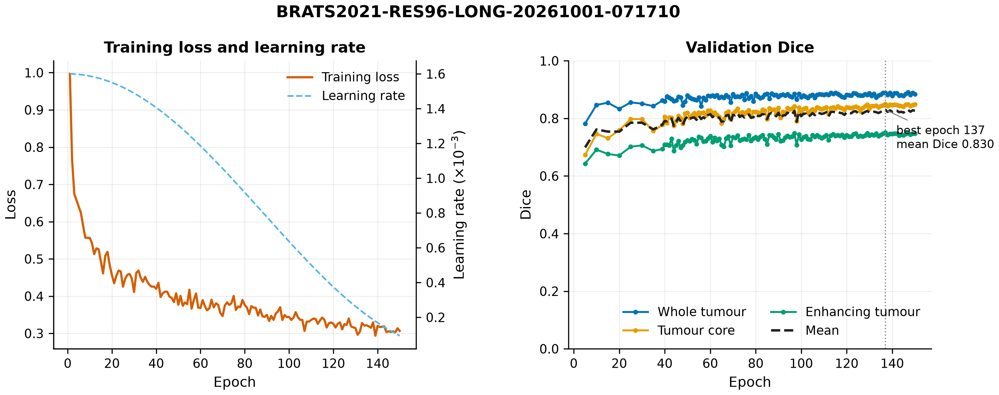
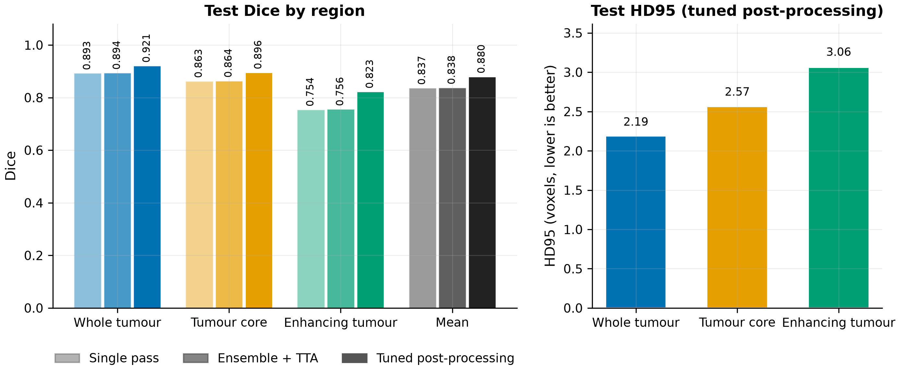
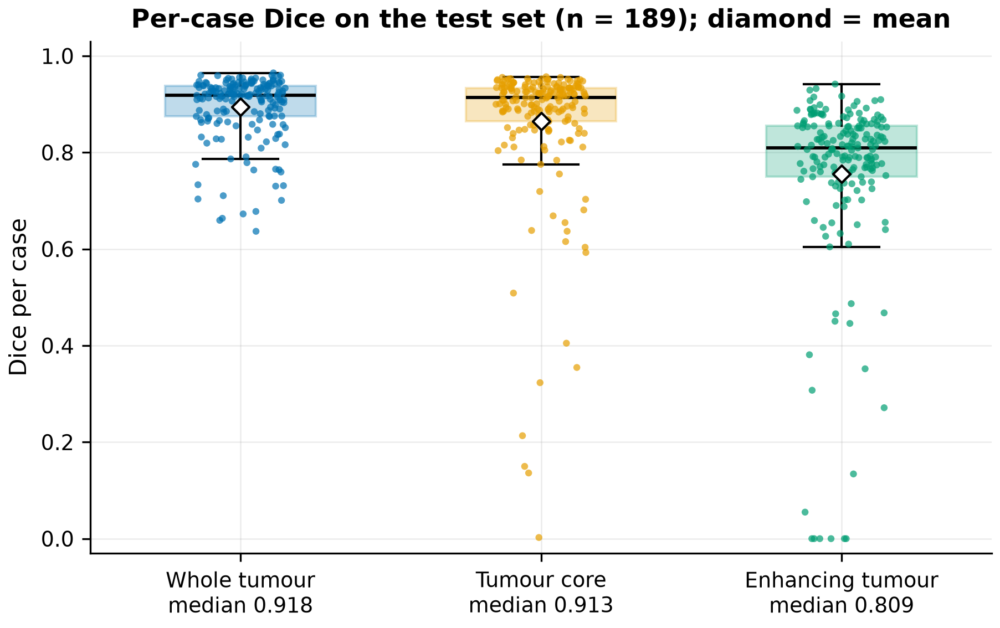
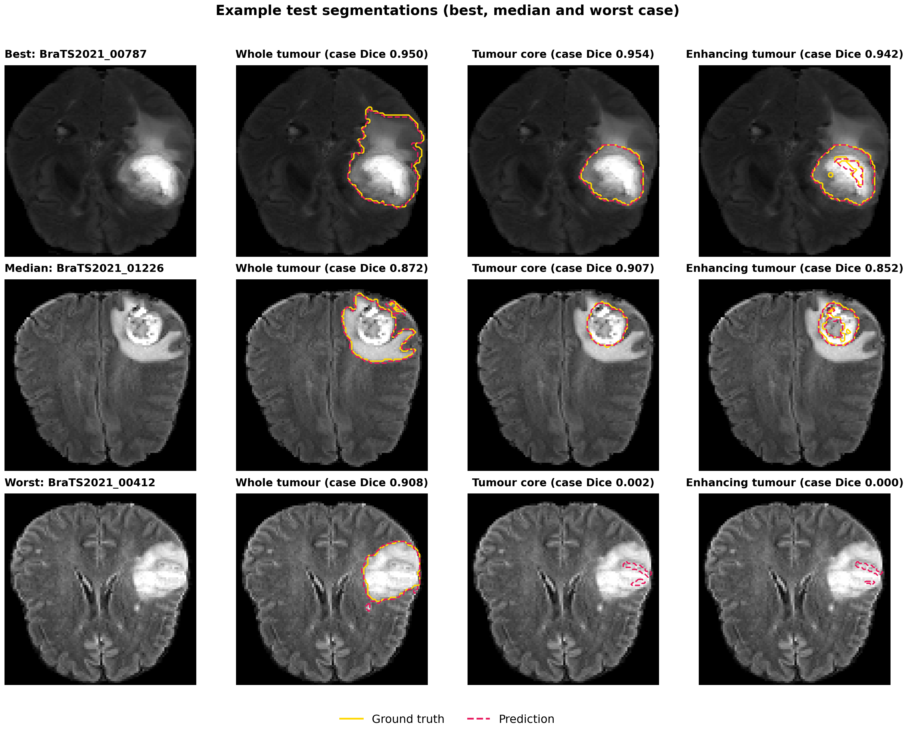

# GLO-NCA Cascade

**GLO-NCA** (Global Context-Aware Neural Cellular Automata) for brain-tumour segmentation
on BraTS: a two-level NCA cascade with channel (SE) and spatial gating blocks and
multi-modal MRI fusion, in about **30,000 parameters**. This repository is the training
package (configs, resumable training, evaluation, figures, CI) and its GCP tooling.

## Results

BraTS 2021: 1,251 glioma cases, seeded random split of 875 training, 187 validation and
189 test patients. Configuration `configs/experiments/brats2021_res96_long.yaml`
(96³ working resolution, augmentation, 150 epochs); best validation epoch 137 (mean Dice 0.830).
The test patients were never used for training, model selection or tuning.

| Test setting (189 patients) | WT Dice | TC Dice | ET Dice | Mean Dice |
|---|---|---|---|---|
| Single pass, 96³ | 0.893 | 0.863 | 0.754 | 0.837 |
| Ensemble ×4 + test-time flips, 96³ | 0.894 | 0.864 | 0.756 | 0.838 |
| **Ensemble ×4 + flips, post-processed, full resolution** | **0.921** | **0.895** | **0.817** | **0.878** |

| Region (post-processed, full resolution) | IoU | HD95 mean (mm) | HD95 median (mm) | Median Dice |
|---|---|---|---|---|
| WT | 0.860 | 4.93 | 2.24 | 0.944 |
| TC | 0.834 | 5.23 | 1.73 | 0.949 |
| ET | 0.723 | 4.49 (184 of 189 cases) | 2.00 | 0.872 |

- The first two rows are scored on the 96³ grid with the v7 Dice formula (an absent region scores 0).
- The last row and the second table come from one evaluation (`evaluate.py --hd95-surface`):
  thresholds WT/TC/ET 0.65/0.65/0.60 and small-lesion clean-up 400/25/400 voxels, both chosen
  on validation; predictions resampled to the original 240×240×155 scans; BraTS scoring, where an
  empty prediction of an absent region scores Dice 1.
- HD95 is the surface-based BraTS/medpy definition in mm; for ET it is undefined in the 5 cases
  where exactly one of the two masks is empty.
- The ensemble passes are stochastic: the training run's own final test of the same setting gave
  0.880 mean Dice (0.921 / 0.896 / 0.823).
- Training: 55.8 h on one NVIDIA L4 (GCP Spot, no preemptions); peak GPU memory 10.4 GB.
- Run history: the run was paused and resumed with changed settings (`train.log`). It validated
  every 5 epochs until epoch 38 and every epoch from epoch 39, which is how epoch 137 was selected;
  early stopping was 20, then 40, then off from epoch 42.

| Figure | Content |
|---|---|
| Training curves | training loss, learning rate and validation Dice per epoch |
| Test summary | the three test settings above and the official HD95 |
| Per-case Dice | every test patient, post-processed at full resolution |
| Example segmentations | best, median and worst test patient on the 96³ grid (ensemble ×4 + flips) |






## Official BraTS 2023 validation (Synapse leaderboard)

The model above was submitted to the **BraTS 2023 Adult Glioma continuous evaluation** on Synapse
(219 validation cases, labels withheld, scored by the organisers; submission 9783550), with the same
setting as the post-processed test row: ensemble ×4 + flips, thresholds 0.65/0.65/0.60, clean-up
400/25/400 voxels, full resolution (`predict.py`).

| Metric | WT | TC | ET | Mean |
|---|---|---|---|---|
| Dice | 0.909 | 0.855 | 0.784 | 0.849 |
| HD95 (mm) | 6.37 | 9.41 | 22.98 | 12.92 |
| Lesion-wise Dice | 0.879 | 0.831 | 0.775 | 0.828 |
| Lesion-wise HD95 (mm) | 17.51 | 20.31 | 30.54 | 22.79 |
| Sensitivity | 0.921 | 0.869 | 0.840 | |
| Specificity | 0.999 | 0.999 | 0.999 | |

With ET post-processing (`predict.py --et-to-ncr 0.25,5000`: a predicted ET that is below 5,000 voxels
and below 25% of the tumour core is relabelled as necrotic core; chosen from the validation results),
submission 9783820:

| Metric | WT | TC | ET | Mean |
|---|---|---|---|---|
| Dice | 0.909 | 0.855 | 0.797 | 0.854 |
| HD95 (mm) | 6.37 | 9.41 | 24.29 | 13.36 |
| Lesion-wise Dice | 0.879 | 0.831 | 0.794 | 0.834 |
| Lesion-wise HD95 (mm) | 17.51 | 20.31 | 27.73 | 21.85 |

On the same validation set, the BraTS 2021 and 2022 winners (nnU-Net based ensembles) report Dice
0.928/0.878/0.845 and 0.927/0.875/0.844 (WT/TC/ET).

Per-case Dice below 0.50 (standard Dice): WT 1, TC 9, ET 22 of 219 cases; Dice 0: TC 2, ET 13.
Of the 13 ET zeros, 7 are cases without enhancing tumour where ET was predicted, 3 are missed ET,
and 3 are misplaced ET; an ET-volume relabelling rule alone changes the ET mean by at most +0.005,
because these false ET regions are as large as true small ones. Per-case scores with predicted
volumes: `docs/results/brats2023_validation_per_case.csv`.

## Model

| | |
|---|---|
| Cascade | 2 NCA levels, coarse then fine (48³ → 96³ for the results above; 32×32×24 → 64×64×48 in v7) |
| NCA cell | 24 channels, hidden 128, 20 + 20 steps, update probability 0.4 (`fire_rate` 0.6 is the skip probability), dropout 0.1, kernels 7 / 3 |
| Context blocks | squeeze-and-excitation (global over channels) + local 7×7×7 spatial gate in every cell; optional attention-pooled global block (`model.use_global`) |
| Fusion | T1, T1ce, T2 and FLAIR stacked as input channels; coarse features fused into the fine level |
| Data | foreground crop, cubic resize, nonzero z-norm, ET-biased patches, optional augmentation |
| Loss | focal Tversky + BCE (β 0.75, γ 1.33, CE weight 0.5), optional per-region weights |
| Optimiser | AdamW, LR 1.6e-3 → 1e-5 per-step cosine, element-wise gradient clip ±1 |
| Weights | EMA 0.999; the best validation epoch is kept as `best.pth` |

The base configs reproduce the original Kaggle v7 script exactly (`legacy/kaggle/kaggle_v7.py`);
`tests/test_equivalence.py` runs both and compares losses, validation and test metrics.
The results above use `configs/experiments/brats2021_res96_long.yaml`.

## Layout

```
glo_nca/                  the package (pip install -e .)
  model.py                GLO-NCA cell: perception, SE, spatial gate, optional global block
  agent.py                cascade agent: coarse-to-fine inference, loss, optimiser step
  losses.py               focal Tversky + BCE loss
  metrics.py              IoU and HD95 (voxel and surface)
  config.py               YAML to settings
  data.py                 BraTS dataset (crop, resize, normalise, cache, patches, augmentation), split
  experiment.py           experiment state: config, split and train/val/test mode
  trainer.py              training loop, EMA, best-model selection, early stopping, final test
  evaluation.py           Dice / IoU / HD95, final decoder, threshold tuning, full-resolution scoring
  checkpoint.py           full checkpoints for exact resume
  reporting.py, plots.py  results JSON, per-case CSV, publication figures
  cli/                    command-line tools (also installed as glo-* commands)
train.py, evaluate.py     thin wrappers so the tools also run from a checkout without installing:
predict.py, ...           train, evaluate, predict, make_figures, compare_runs, benchmark, analyze
configs/                  base recipes; configs/experiments/ inherit and extend them
reproduce.sh              reproduce the reported test table from the released weights
MODEL_CARD.md             data, results, intended use and limitations of the released model
legacy/kaggle/            the original Kaggle scripts (v4-v7); they run against tag kaggle-v7-reference
tests/                    unit checks, pipeline test, v7 equivalence test, synthetic data generator
docker/, cloud/           training image; GCP scripts and systemd units
docs/                     figures and per-case results of the reported run
.github/workflows/        CI: unit and pipeline tests on every push, v7 equivalence weekly
```

## Install

```bash
pip install torch==2.5.1 --index-url https://download.pytorch.org/whl/cu121   # or the CPU index
pip install -e .                    # the package and the glo-train, glo-evaluate, glo-predict,
                                    # glo-figures, glo-compare, glo-benchmark and glo-analyze commands
pip install -r requirements.lock    # optional: the exact versions behind the reported results
```

## Reproduce the reported results

```bash
./reproduce.sh /path/to/BraTS2021
```

downloads `best.pth`, `config.yaml` and `split.json` from the release (or uses them if present in
`release/glo-nca-brats2021-res96/`), scores the 189 test patients with the reported setting and
compares with the table above (Dice within ±0.005; the ensemble passes are stochastic).
See `MODEL_CARD.md` for the model's data, intended use and limitations.

## Train locally

```bash
pip install -e .                    # install torch first from the CUDA index
python train.py --config configs/experiments/brats2021_res96_long.yaml --data-root /path/to/BraTS2021
python train.py --resume experiments/<run-id> --data-root /path/to/BraTS2021
python train.py --config configs/glo_nca_cascade.yaml --data-root /path/to/BraTS --stop-after-epoch 10
```

Each run writes to `experiments/<run-id>/`: `config.yaml`, `split.json`, `train.log`,
`history.csv`, `status.json`, `last.pth` (every epoch, for resume) and `best.pth`
(EMA weights of the best epoch). The final test adds `results.json`, `test_per_case.csv`
and `figures/` (training curves, test summary, per-case Dice, example segmentations).

## Configuration options

All are off by default, so the base configs reproduce the v7 recipe; experiment configs
switch them on through `base:` inheritance, and `--override section.key=value` sets any value.

| Setting | Effect |
|---|---|
| `model.input_size` | working resolution, e.g. `[[48,48,48],[96,96,96]]` |
| `data.augment` | training-only flips, in-plane 90-degree rotations and intensity jitter |
| `data.cache` | `memory`, `disk` (low RAM, shared by workers) or `none` |
| `loss.tversky_beta`, `loss.region_weights` | recall/precision balance and loss weight per region |
| `training.val_every` | validate every N epochs (always on the last and the pause epoch) |
| `training.early_stop_patience`, `early_stop_min_delta` | stop when validation stops improving |
| `evaluation.tune_thresholds` | per-region threshold and clean-up size, chosen on validation |
| `evaluation.full_resolution` | score in the original scan space |
| `evaluation.brats_empty` | BraTS scoring of absent regions |
| `experiment.split_seed` | fixed split, so runs with other seeds can be ensembled |
| `model.use_se`, `model.use_spatial` | channel SE block and local spatial gate, each on or off (ablations) |
| `model.use_global` | attention-pooled global-context block (GCNet style) added to every cell |
| `model.update_prob` | probability that a cell updates per step; `fire_rate` is the skip probability (0.6 = 40% update) |
| `loss.all_regions` | score every region, also when its target is empty, so false positives are penalised |
| `training.validate_ema` | select the best epoch on the EMA weights that `best.pth` saves |
| `data.crop_et_prob` | share of training crops centred on enhancing tumour, at the crop that is trained on |
| `evaluation.nested_regions` | score the final nested masks (TC includes ET, WT includes TC), as written by `predict.py` |
| `evaluation.surface_hd95` | surface HD95 (BraTS definition) in mm, using each scan's voxel spacing |
| `model.norm` | `batch` (BatchNorm over the volume) or `layer` (per-voxel, strictly local update) |
| `loss.bce_logits` | BCE computed on logits instead of clamped probabilities |
| `data.brain_mask` | one brain mask (any modality non-zero) for resizing and normalisation |
| `data.et_labels` | labels counted as enhancing tumour (default 3 and 4); unknown labels stop loading |
| `training.amp` | `bf16`: autocast the training forward pass to bfloat16 (loss in float32) |
| `training.grad_checkpoint` | recompute each NCA step in the backward pass: less memory, identical gradients |
| `evaluation.case_seed` | seed the stochastic inference passes per case, so predictions repeat exactly |

`configs/experiments/brats2021_res96_fixed.yaml` switches all of the corrections above on;
`brats2021_res96_fixed_plain.yaml` is its ablation control without SE and spatial gate, and
`brats2021_res96_fixed_global.yaml` adds the global-context block. The results above were produced
before these corrections, with all of them off: the loss skipped regions absent from a crop,
validation scored the live weights while `best.pth` holds the EMA weights, the training crop was
uniformly random, and the spatial block is a local 7×7×7 gate rather than a global operator.

## Evaluate and ensemble

```bash
python evaluate.py --run experiments/<run-id> --data-root /path/to/BraTS2021 \
    --tune-thresholds --full-resolution --brats-empty
python evaluate.py --run experiments/<run-id> --data-root /path/to/BraTS2021 --splits test \
    --full-resolution --brats-empty --hd95-surface --thresholds WT=0.65,TC=0.65,ET=0.6
python evaluate.py --run experiments/<run-a> --run experiments/<run-b> --run experiments/<run-c> \
    --data-root /path/to/BraTS2021 --tune-thresholds --full-resolution
```

Two runs on the same test cases are compared with
`python compare_runs.py experiments/<run-a> experiments/<run-b>` (difference B minus A, 95%
bootstrap interval over patients, Wilcoxon test, Holm correction for WT/TC/ET), and inference cost
is measured with `python benchmark.py --run experiments/<run-id> [--device cpu]`.

`analyze.py` adds the analyses of a trained run: `decompose` scores the same seeded passes after each
inference stage (single pass, ensemble, flips, thresholds, clean-up, ET rule) at full resolution;
`steps` measures accuracy and latency for other NCA step counts; `erf` measures the effective
receptive field from input gradients; `overlap` checks an official ID mapping table for evaluation
cases that were in training. Every start or resume of a run records its commit, Docker image,
software versions and GPU in `run_info.json`.

Without tuning, cases are scored one at a time into a progress file, so an interrupted
evaluation resumes where it stopped. Ensemble members must share `split.json` and the
working resolution.

## Train on GCP

Copy `cloud/config/gcp.env.example` to `cloud/config/gcp.env` and fill it in, then:

```bash
./cloud/scripts/start_vm.sh                      # from your machine
./cloud/scripts/setup_gcp.sh                     # on the VM: checkout and image build
./cloud/scripts/run_training.sh --config configs/experiments/brats2021_res96_long.yaml \
    --data-root /data/brats2021 --auto-stop --keep-alive
./cloud/scripts/status.sh                        # progress
./cloud/scripts/watchdog.sh                      # from your machine: restart after Spot preemptions
```

Runs are synced to `gs://<bucket>/experiments/<run-id>/` every 5 minutes. With
`--keep-alive` a restarted VM resumes the run from its last epoch; `watchdog.sh` restarts
the VM only after a preemption, and `--auto-stop` powers it off when the run ends.

## Verify

```bash
python tests/test_options.py                                   # unit checks, no data needed
python tests/test_pipeline.py                                  # train, predict, evaluate, compare, benchmark
python tests/make_synthetic_data.py /tmp/syn --cases 12         # synthetic BraTS-style cases
python tests/test_equivalence.py /tmp/syn                       # identical to the Kaggle v7 script
```

## Credits

Built on the Med-NCA / M3D-NCA framework by John Kalkhof et al. (MIT). See `LICENSE`.
